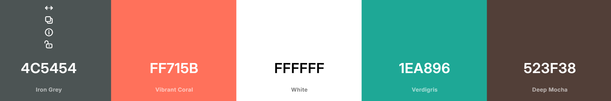

## AI usage declarations

### Quadri

#### What I Own

I sourced the design system from Coolors, designed the Avera logo, planned the color layouts, and architected the overall look and structure of the dashboard. The frontend's visual direction and user experience are based on my design decisions.

#### How I Used AI

AI supported the refinement of my frontend work. My initial 3D map needed more precise calculations so its models would be readable, well arranged, and visually polished. Claude helped refine those details and make the map look professional in 3D. AI also helped improve the prose and text formatting across the hypothesis dashboards.

### Raufu

#### What I Own

I defined the product requirements, reviewed the PRD and work split, and made the architectural decisions for the simulated-bank MVP. I wrote the system logic and defined the events and API structures used across the platform. I also worked on the observability UI, which helps us monitor the logs from our server. I reviewed each module, provided infrastructure access, and decided how approvals, agents, Kafka, and the frontend should behave.
i worked on the system desgn infra first of Excalidraw before writing code to ensure the system is functional.

#### How I Used AI

I used Codex as a technical partner to help write tests, audit teammates' contributions, and prepare the system for integration with the agents. It also validated my reasoning on infrastructure and deployment tasks involving PostgreSQL, Kafka, the VPS, DNS, HTTPS, and CI/CD, while helping diagnose approval, persistence, and integration issues.

### Shazily

#### What I Own

I worked on Avera's Observability Agent, the central intelligence layer that makes sense of incoming system data. I wrote the logic that enables the agent to comprehend signals, connect related clues, detect incidents, map suspect zones, form competing hypotheses, rank likely causes, and prepare the handoff to Ghost Test.

#### How I Used AI

I used Codex to generate synthetic test data that helped me verify how the Observability Agent connects signals and identifies incidents. The agent's reasoning logic, behaviour, and integration validated the data and work.

### Adam

#### What I Own

I own Avera's post-validation remediation path. I designed and wrote the code of how a confirmed Ghost Test handoff becomes a fix plan, blast-radius assessment, human approval, approved action, and verified resolution. I defined the domain rules, approval boundaries, impact logic, and agent behaviour, then reviewed the implementation, tests, and integration contracts to ensure they matched the product requirements.

#### How I Used AI

I used Cursor as a coding partner to help implement and refactor the remediation package, identify contract gaps, write and improve tests, investigate failures, and review the work for weak points. It helped me move faster and stress-test my decisions.
