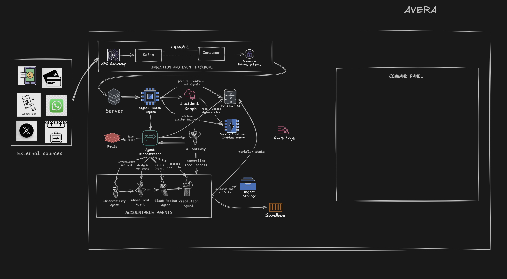

# Avera Incident Command Centre

Avera is an incident-intelligence platform for digital banking. It correlates operational signals and customer reports, tests competing explanations, and presents human-reviewed resolution actions in one command centre.

## High-level system design (target)



External operational and customer signals enter through an API gateway and Kafka event backbone. The platform correlates signals into incidents, keeps incident and workflow state, and orchestrates accountable agents through a controlled AI gateway. Evidence, audit logs, and sandboxed changes support human review in the command panel.

## Current MVP

The current implementation is a single-bank simulation, not a live banking integration. It includes a simulated bank and incident traffic, an ordered event API and SSE stream, deterministic Ghost Tests, an isolated route twin, in-platform approval records, and simulated route changes. PostgreSQL and Kafka/Redpanda adapters are available when configured; local development defaults to in-memory adapters.

Shaz's Observability Agent now parses reported complaint facts, detects behavioural signals and incident changes, maps suspect components, generates competing hypotheses, and hands validated candidates to the existing Ghost Test workflow. See [setup, run commands, evidence boundaries, and fixture limitations](docs/observability.md).

Ghost Test can optionally use GPT-5.4 Mini to summarize aggregate test results. The model does not choose the verdict, score hypotheses, approve actions, or change routes. External source/platform connections shown in the design remain integration work.

## Run locally

Start the backend:

```bash
cd backend
python -m pip install -r requirements.txt
PYTHONPATH=. uvicorn avera.api.app:app --reload
```

Start the frontend in another terminal:

```bash
cd frontend
npm install
npm run dev
```

Open `http://localhost:5173`.

Build the frontend for production:

```bash
cd frontend
npm run build
```

The command centre includes incident health and feed, service map, hypotheses and Ghost Test runs, customer impact, fix plan, approvals, timeline, and institutional memory. The hidden demo controller opens from the header or with the `D` key and can replay the local fixture story.

Run the backend regression suite, including ten full seeded incident cycles:

```bash
cd backend
python -m pip install -r requirements-dev.txt
PYTHONPATH=. pytest -q
```

For optional GPT summaries, set `OPENAI_API_KEY` and `AVERA_GHOST_SUMMARY_MODEL=gpt-5.4-mini` in the backend environment. Without these settings, summaries use the local deterministic fallback.

## Safety boundary

All bank, customer, payment, and SMS data in the demo is synthetic. The API does not move real funds, contact real customers, send SMS, or execute production changes. Approval and route APIs operate only on the simulated bank.
