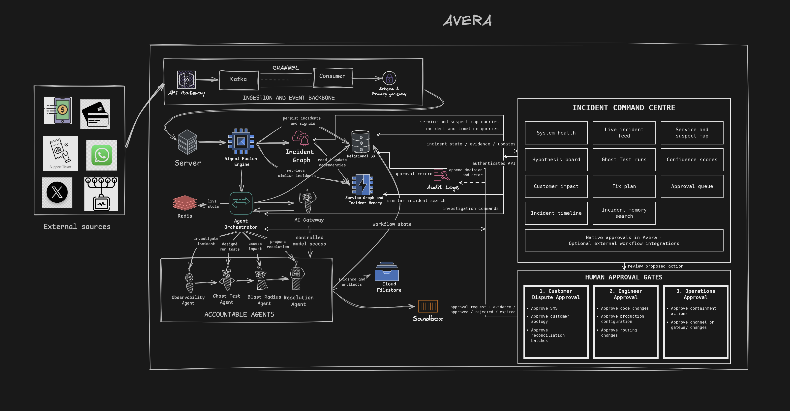

# Avera

Avera is an AI-assisted incident command centre for digital banking. It turns fragmented operational signals and customer reports into an evidence-backed incident, tests competing explanations in a digital twin, maps customer impact, and prepares guarded recovery actions for human approval.

The current MVP models one bank and one high-value transfer incident end to end. All customers, transactions, routes, messages, and approvals are simulated; no real funds, customer contacts, payment rails, or production banking systems are connected.

## System architecture



The target architecture separates signal ingestion, incident intelligence, decision support, and human control:

| Layer | Responsibility |
| --- | --- |
| Ingestion and event backbone | Accept operational and customer-channel events, validate schemas, preserve ordering, and distribute notifications through Kafka. |
| Signal fusion and incident graph | Correlate complaints, behavioural changes, service telemetry, and route failures into one incident fingerprint. |
| Accountable agents | Investigate evidence, run safe disproof tests, calculate blast radius, and prepare a recovery plan. |
| State and memory | Persist the ordered event stream, workflow snapshots, approvals, audit records, and simulated route state in PostgreSQL. |
| Incident Command Centre | Present service health, the scenario map, hypotheses, Ghost Tests, customer impact, plans, approvals, and the incident timeline. |
| Human approval gates | Keep customer communication, configuration changes, code changes, and reconciliation work under named human authority. |

In the implemented MVP, HTTP ingestion is the source boundary. PostgreSQL is the durable event and workflow store, Kafka is the outbound event-notification bus, and Server-Sent Events deliver the ordered stream to the command centre. The architecture diagram also shows the intended next-stage Kafka ingestion path and external platform integrations.

## Incident workflow

1. **Observe** — typed events arrive through the ingestion API and are normalized into a shared event envelope.
2. **Correlate** — the Observability Agent fuses complaints and behavioural signals, opens an incident, identifies suspect zones, and ranks competing hypotheses.
3. **Disprove** — the Ghost Test Agent runs deterministic experiments against an isolated route twin. GPT may summarize aggregate results, but it cannot score evidence or choose the verdict.
4. **Scope** — the Blast Radius Agent applies the validated fingerprint to synthetic bank records, identifies affected and silent customers, and prepares a policy-safe recovery plan.
5. **Approve** — routing, customer-message, code, and reconciliation actions enter an auditable in-platform approval queue. The scenario map stops at the routing gate and continues to surface unresolved follow-up decisions after containment.
6. **Resolve and verify** — an approved simulated route change is applied, the original Ghost Tests are rerun, live signals are checked, and the incident is written to memory with open follow-ups.

## Accountable agents

- **Observability Agent** — parses reports, detects behavioural changes, creates the incident fingerprint, and generates evidence-linked hypotheses.
- **Ghost Test Agent** — designs deterministic disproof tests, compares suspect and control routes, and validates or rejects each hypothesis.
- **Blast Radius Agent** — calculates affected customers and exposure from the validated fingerprint, then prepares communications and remediation steps.
- **Resolution Agent** — requests approvals, applies only approved simulated actions, verifies recovery, and records the decision trail.

The agents share one ordered event stream and explicit contracts. Production-facing authority always remains outside the model.

## MVP capabilities

- Single-bank traffic simulation with thousands of synthetic events
- API ingestion for logs, metrics, complaints, social reports, support tickets, and behavioural signals
- PostgreSQL-backed ordered events, transactional outbox, and durable workflow snapshots
- Managed Kafka or local Redpanda delivery with at-least-once semantics
- Live SSE updates for the Incident Command Centre
- Deterministic Ghost Tests and an isolated route twin
- Evidence-scoped customer impact and remediation planning
- Payload-bound, hash-verified in-platform approvals
- Simulated route application, rollback guardrails, and post-change verification
- Sanitized operational console at [`/observe`](https://api.avera.clippit.click/observe)

This is a technical MVP, not a production banking control plane. Approval routes are intentionally unauthenticated for the public demo and must be protected with bank identity, authorization, network controls, secrets management, and production-grade observability before any real integration.

## Repository structure

```text
backend/
  avera/api/             FastAPI routes, SSE, health, and observability UI
  avera/events/          Event contracts, persistence, Kafka, and outbox delivery
  avera/observability/   Signal fusion, hypothesis generation, and investigation
  avera/remediation/     Blast radius, approvals, resolution, and audit workflow
  avera/simulation/      Synthetic bank, traffic, and failure injection
  tests/                 Backend and end-to-end regression suites
frontend/
  src/                   Incident Command Centre and live scenario map
  public/                Product and agent assets
docs/                    Tracked technical documentation and agent-flow diagrams
```

## Run locally

Requirements: Python 3.11+, Node.js 20+, and optional PostgreSQL plus Kafka/Redpanda for durable mode.

Start the API:

```bash
cd backend
python3 -m venv .venv
.venv/bin/python -m pip install -r requirements-dev.txt
PYTHONPATH=. .venv/bin/python -m uvicorn avera.api.app:app --reload --port 8766
```

Start the command centre in another terminal:

```bash
cd frontend
npm install
npm run dev
```

Open `http://localhost:5173`. Vite proxies `/api/*` to `http://127.0.0.1:8766` by default. Copy values from the tracked [`backend/.env.example`](backend/.env.example) and [`frontend/.env.example`](frontend/.env.example) when configuration overrides are needed; keep credentials out of version control.

Without PostgreSQL or Kafka configuration, the backend uses in-memory adapters. Durable mode requires `AVERA_DATABASE_URL` and `AVERA_KAFKA_BOOTSTRAP_SERVERS`; authenticated managed Kafka additionally requires the SASL/TLS variables documented in the backend environment example.

## API surface

| Endpoint | Purpose |
| --- | --- |
| `POST /demo/run` | Start a fresh baseline, inject the synthetic failure, and begin investigation in one request. |
| `POST /demo/start`, `/demo/inject`, `/demo/reset` | Control the baseline and failure stages separately. |
| `POST /ingest/{source}` | Accept typed external-source events. |
| `POST /hypotheses` | Submit hypotheses for deterministic Ghost Test evaluation. |
| `POST /twin/simulate` | Evaluate a candidate route in the isolated twin. |
| `GET /remediation/{incident_id}` | Read the impact analysis, fix plan, and resolution state. |
| `GET /approvals`, `GET /approvals/{id}`, `POST /approvals/{id}` | Read and decide payload-bound simulated approvals. |
| `GET /stream` | Consume the ordered incident stream over SSE. |
| `GET /service-map`, `GET /health` | Read topology, route state, and dependency health. |
| `GET /observe` | Open the sanitized backend operations console. |

The hosted MVP API is `https://api.avera.clippit.click`. The deployed web client is `https://avera-lilac.vercel.app`; direct browser clients must be listed as exact origins in `AVERA_CORS_ORIGINS`.

The frontend also includes a contained mock-bank repair journey at `/bank`. It reproduces a duplicate debit caused by an unstable retry idempotency key, lets one constrained repair agent edit an isolated source workspace, runs regression tests, and verifies the original transfer journey before showing a resolution report.

## Verification

Run the backend regression suite:

```bash
cd backend
.venv/bin/python -m pytest -q
```

Build the frontend:

```bash
cd frontend
npm run build
```

The regression suite covers event ordering, PostgreSQL persistence, Kafka security configuration, observability-to-remediation handoff, approval integrity, restart recovery, route application, rollback, and end-to-end demo readiness.

## Technical references

- [API contract and persistence boundary](backend/avera/API_CONTRACT.md)
- [Observability Agent](docs/observability.md)
- [Remediation agents and approval model](docs/remediation.md)
- [Backend operations and deployment](backend/README.md)

