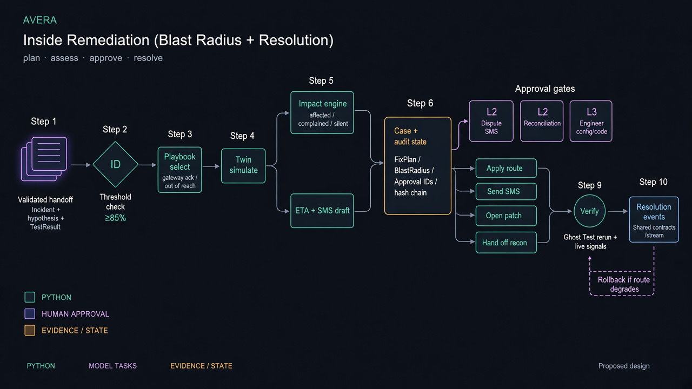

# Adam's Remediation Agents (Blast Radius + Resolution)

This component owns the post-validation path: plan the fix, compute blast radius,
raise human approvals, execute approved actions, and verify restoration. It uses
`avera.contracts`, the digital twin / admin route surfaces, Ghost Test rerun, and
the shared `/stream` envelope via `wire.py`. It does not own hypothesis generation,
Ghost Test scoring, the simulated bank itself, or the Incident Command Centre UI.

## Run from the repository root

Use Python 3.11 or newer (the existing shared contracts require it). Create a
local virtual environment if `.venv` does not exist. From the repository root:

```bash
python3 -m venv .venv
.venv/bin/python -m pip install -r backend/requirements-dev.txt
```

Remediation does not call OpenAI. No model key is required for this component.
Observability’s LLM settings in `backend/.env` are unrelated to these agents.

Then check the focused suite and the fixture walkthrough:

```bash
PYTHONPATH=backend .venv/bin/python -m pytest backend/tests/remediation -q
PYTHONPATH=backend .venv/bin/python -m avera.remediation.demo
```

Expected: the focused suite reports all remediation tests passed; the demo prints
the validated handoff (H1 at 96%), blast radius counts on seeded data
(1,284 transactions / 1,109 affected / 13 complained / 1,096 silent), a
playbook fix plan with twin simulation, SMS awaiting Customer Dispute approval,
then resolution events after simulated approvals (route applied, Ghost Test
rerun passed, patch opened for review).

The fixture demo builds a deterministic stand-in for bank data, twin, routing,
contacts and SMS. The in-process integration path (`avera.remediation.integration`)
joins observed simulator events to the same agents when the full API demo is
running. Shared contracts are unchanged; richer internal models are projected
outward by `wire.py` before publish.

To serve remediation through the existing backend instead:

```bash
.venv/bin/python -m pip install -r backend/requirements-dev.txt
PYTHONPATH=backend .venv/bin/python -m uvicorn avera.api.app:app --app-dir backend --env-file backend/.env --reload
```

`POST /demo/start` and `POST /demo/inject` drive the healthy-then-fault path.
After Ghost Test validates a hypothesis at or above the handoff threshold, the
orchestrator can hand a `ValidatedHandoff` into remediation. Useful routes:

- `GET /remediation/{incident_id}` — fix plan, blast radius, resolution timeline
- `GET /approvals`, `GET /approvals/{id}`, `POST /approvals/{id}` — pending
  approvals and public simulated decisions (role derived server-side; decision
  bound to the current payload hash)
- `POST /twin/simulate` — containment preview used by Blast Radius before asking
  for engineer approval
- `POST /admin/route` — apply an approved route change (Resolution only)
- `POST /ghost-test/rerun` — post-fix verification used before close

`POST /demo/reset` clears demo state. No real bank, customer phone platform, or
payment rail is contacted by this MVP.

## Evidence and decision boundary

Remediation starts only from a validated handoff: Incident, winning Hypothesis,
winning TestResult, and rival results. Handoffs below the confidence threshold
(default 85%) or without a validated verdict are rejected. The agent never
re-decides the cause; Ghost Test remains the source of proof.

Blast Radius selects a deterministic playbook from the hypothesis zone and
control route (MVP: gateway acknowledgement failure with a healthy alternate
route; otherwise out-of-reach escalation). Containment is simulated in the
digital twin before any engineer approval is requested. Failed simulation falls
back to an engineer alert rather than inventing a risky change.

Impact matching uses playbook-named fingerprint traits (for gateway failures:
`route`, `destination_bank`, `error_code`). Change markers such as `app_version`
are candidate causes, not impact scope. Definitions locked for the demo:

- **Affected** — customer with at least one fingerprint-matching transaction in
  the incident window
- **Complained** — affected customer with an explicit complaint the parser
  matched to one of *their* affected transactions
- **Silent** — affected and not complained; behaviour signals never move a
  customer out of silent and are counted separately as `silent_with_signals`

Time estimates come from the plan’s critical path. The apology SMS ETA phrase is
taken from that estimate (soft fallback wording when confidence is low). SMS
content is GSM-7 only, capped at two segments, and blocked from links, account
numbers and credential requests. Phone numbers are resolved at send time only.

Nothing reaches a customer or production without a recorded approval:

| Kind | Level | Role |
|---|---|---|
| `sms`, `reconciliation` | 2 | Customer Dispute |
| `config`, `code` | 3 | Engineer |

Decisions must quote the `payload_hash` of the payload that was shown. Requesters
cannot approve their own requests. New plans supersede pending subjects.
Approvals expire. Reconciliation batches are prepared only; no code path moves
customer money. Approving a route change also pre-approves its stated rollback;
if the new route’s error rate breaches the threshold inside the watch window,
routing is restored and engineers are alerted.

Resolution closes containment only when the Ghost Test rerun passes **and** live
signals return to normal. Open follow-ups (patch review, reconciliation hand-off)
are listed on the resolved event. Every plan, approval and action is written to a
hash-chained audit log.

## Replay and known integration limits

```bash
PYTHONPATH=backend .venv/bin/python -m avera.remediation.demo
```

The fixture path is the reliable standalone proof of this component. Live numbers
depend on Koded’s seed / observed transactions matching the demo fingerprint.
`reconciliation` exists as an internal approval kind; if the shared
`ApprovalKind` enum does not yet include it, that approval is held back from
`/stream` so schema validation is not broken (see `wire.py`).

Durable restart recovery for in-memory remediation cases, multi-incident
lifecycle management, and bounded autonomy playbooks beyond the MVP gateway
failure are out of scope for this slice. Observability prompts, Ghost Test
experiment design, and Platinum’s UI were not certified by the remediation unit
suite; end-to-end coverage lives in the wider backend tests and demo path.

## Checks

```bash
PYTHONPATH=backend .venv/bin/python -m pytest backend/tests/remediation -q
```

For the full backend regression:

```bash
PYTHONPATH=backend .venv/bin/python -m pytest backend/tests -q
```

`tests/remediation/` covers handoff rejection, playbook selection, twin fallback,
blast-radius definitions and demo counts, SMS policy, approval roles / hash /
expiry / supersede, route apply + Ghost Test verify, rollback, SMS opt-out, and
the money / approval guardrails. Fixture data is deterministic across runs.

## Agent flow

The diagram shows how a validated cause becomes a planned fix, a blast radius, human
approvals, approved actions, and verified resolution. Python owns playbooks, impact
math and execution; humans own every customer- and production-facing gate.


