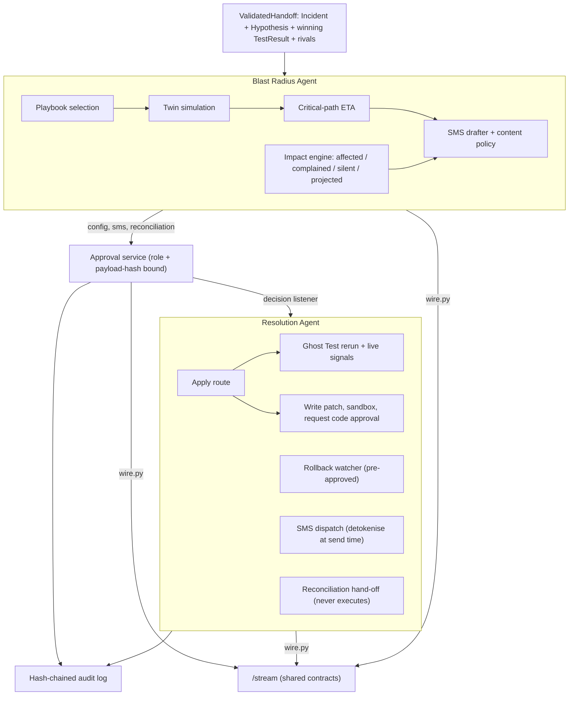

# Remediation domain: Blast Radius + Resolution agents (owner: Adam)

Turns a validated hypothesis into a fix plan, a blast radius, approval requests and verified actions.

- Code: `backend/avera/remediation/`. Tests: `backend/tests/remediation/`.
- Walkthrough: `cd backend && python -m avera.remediation.demo`. Tests: `python -m pytest tests`.
- Inputs are Koded's shared contracts (`avera/contracts.py`) used directly. Outputs are richer internal models
  (`models.py`) converted to the shared contracts by `wire.py` before anything reaches `/stream`.

## Decisions

| Topic | Decision |
|---|---|
| Affected | Customer with at least one transaction matching the incident fingerprint inside the incident window (from `fingerprint.first_seen`) |
| Impact scope | The playbook names which fingerprint traits scope impact. Gateway failures use `route`, `destination_bank`, `error_code`. Change markers like `app_version` are candidate causes, never scope |
| Complained | Affected customer with an explicit complaint (any channel) the parser matched to one of *their* affected transactions |
| Silent | Affected and not complained. Behaviour signals never move a customer out of silent; counted as `silent_with_signals_count` |
| Projection | Newly affected customers per minute over the last 5 min, multiplied by containment ETA |
| Money | Integer kobo internally; `Decimal` naira on the wire. No port or planned action can move money; tests enforce it |
| Approval kinds | `sms` and `reconciliation` are Level 2 (Customer Dispute); `config` and `code` are Level 3 (Engineer) |
| Approval integrity | Every decision must quote the `payload_hash` the approver saw (shipped inside `Approval.payload`). New plans supersede pending requests. Requesters cannot approve. Approvals expire after 4 hours |
| SMS | The dispute team approves the exact rendered messages. Fix time comes from the plan; low-confidence estimates use "will update you" wording. GSM-7 only (so "N", not the naira sign), max 2 segments, no links, account numbers or credential requests. Ref is the incident ID |
| Rollback | Approving a route change also approves its stated rollback. Watched for the rollback window; firing it alerts engineers |
| Closing | Resolved only when the Ghost Test rerun passes **and** live signals are normal. Open follow-ups are listed on the resolved event |
| Plans | Deterministic playbooks, not raw LLM output. Unknown causes fall through to the out-of-reach playbook (engineer alert); so does a failed twin simulation |
| IDs | Deterministic, matching the recorded fixture: `plan-{incident}`, `blast-{incident}`, `approval-{kind}-{incident}`, `resolution-{incident}-{seq}` |

## Shared-contract gaps to raise with Koded

- [ ] `ApprovalKind` has no `reconciliation`. Reconciliation approvals are held back from `/stream` until it does.
- [ ] `ApprovalStatus` has no `superseded` / `expired`; they are sent as `rejected` by `avera-system` with `payload.closed_reason`.
- [ ] `BlastRadius` has no `complained_count`, `silent_with_signals_count` or `projected_count` (the UI shows complained and prevention rate).
- [ ] `FixPlan` has no simulation success rate (the UI shows 96.7%) and no per-step status or approval gate.
- [ ] `ResolutionEvent` has no `approval_id`, timestamp or detail (e.g. SMS sent / opted-out counts). Internal history is kept per case.
- [ ] No object carries `incident_id` except inside `Approval.payload`; fine for one incident, not for several.
- [ ] Fixture timestamps tell the PRD's wall-clock story (10:42, 10:51) in UTC. A Nigerian bank shows Lagos time, so either the fixture moves to `+01:00` or the demo renders in UTC (current demo setting).

## Asks for Koded (needed but not in the API table)

- [ ] Call `Remediation.on_validated(handoff)` after the 85% handoff rule, and mount `avera.remediation.approvals.api.build_router` for `POST /approvals/{id}`.
- [ ] Transfers by fingerprint traits and time window, complaints and behaviour signals by window (`BankData` port).
- [ ] Live metrics: route error rate by destination and route over a window (rollback trigger).
- [ ] Live "signals back to normal" check per incident (closing condition).
- [ ] Flip the incident to `resolved` on `mark_incident_resolved`.
- [ ] Contact directory: customer token to phone and SMS preference, resolved at send time.
- [ ] Simulated SMS gateway with idempotency keys, feeding the customer phone view.
- [ ] Sandbox runner for patches against the simulated bank's tests.
- [ ] Gateway B failure implemented as a real defect in the connector code (ack timeout / retry handling), so the patch genuinely fixes it.
- [ ] Seed data producing 1,284 transfers / 1,109 customers for the demo fingerprint, consistent with the 13 recorded complaints.

Each ask maps to a Protocol in `backend/avera/remediation/ports.py`; `backend/avera/remediation/fixtures.py` is the stand-in until the real adapter exists.
